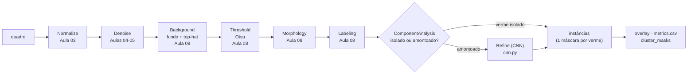

# Segmentação de *C. elegans* — PDI clássico + CNN

Repositório: <https://github.com/Nixxye/PDI-C.Elegans>

Dado um quadro de uma placa com vários *C. elegans*, o programa **separa cada verme do fundo e dos outros**. O trabalho tem duas partes:

1. **PDI clássico** (técnicas da disciplina): isola os vermes e detecta os **amontoados** (vermes que se tocam ou se cruzam).
2. **CNN** (`celegans_seg/cnn.py`): recebe cada amontoado e devolve **uma máscara por verme**.

Dados: dataset do WormSwin, CSB-1 ([Zenodo 7456803](https://zenodo.org/records/7456803), CC BY 4.0). Mais detalhes em [`docs/DADOS.md`](docs/DADOS.md).

## Resultado (sequência de teste `24_2_1_1`, nunca usada no treino)

| | Só PDI | PDI + CNN |
|---|---|---|
| F1 por verme (IoU ≥ 0,5) | 0,74 | **0,90** |
| Recall | 0,75 | **0,97** |
| Precisão | 0,74 | 0,85 |
| Recall dos vermes que estão em amontoados | 0,05 | **0,91** |
| Dice da máscara (união dos vermes) | 0,85 | 0,85 |

Só nos amontoados (574 recortes, 1.291 vermes): watershed clássico F1 0,69; **CNN F1 0,93**.
**Leia as limitações abaixo antes de confiar nesses números.**

## Como rodar

```bash
pip install -r requirements.txt          # o torch só é preciso para a CNN

# sem dados reais: gera uma sequência sintética com gabarito
python tools/make_synthetic.py --out data/synthetic --seq seq0
python run_pdi.py --dataset-root data/synthetic --seq seq0 --out runs/synth

# com o CSB-1 (descompactado em data/csb-1_extracted/csb-1_dataset)
python run_pdi.py --dataset-root data/csb-1_extracted/csb-1_dataset --seq 24_2_1_1 --out runs/csb1
python run_pdi.py ... --set refine.kind=cnn          # liga a CNN (usa models/cluster_cnn.pt)
python run_pdi.py --images <pasta com quadros> --out runs/meu_video   # qualquer pasta de quadros, sem gabarito

python -m unittest discover -s tests
```

Qualquer parâmetro do `config.yaml` muda na linha de comando com `--set secao.campo=valor` (ex.: `--set threshold.method=adaptive --set input.step=2`).

### Ver o pipeline passo a passo

```bash
python tools/step_viewer.py --dataset-root data/csb-1_extracted/csb-1_dataset --seq 24_2_1_1 --frame 59
python tools/step_viewer.py ... --set refine.kind=cnn      # mostra também o que a CNN separou
```

Abre uma janela com 12 painéis (um por etapa, mais o gabarito). Os eixos são compartilhados: o zoom da barra do matplotlib vale para todos os painéis. Setas ←/→ trocam de quadro (±1), ↑/↓ (±10) ou use o slider; `q` sai. Para só gravar a figura: `--save etapas.png`; para começar com zoom: `--zoom y0,y1,x0,x1`.

## Como funciona



| Estágio | O que faz | Slide | Código |
|---|---|---|---|
| Normalize | gamma, autocontraste | Aula 03 | `ops.gamma_correct`, `ops.autocontrast` |
| Denoise | gaussiano (padrão), mediana, bilateral | Aulas 04 e 05 | `ops.gaussian`, `ops.median`, `ops.bilateral` |
| Background | `sinal = fundo − quadro` (fundo = percentil 70 de ~25 quadros); top-hat | Aula 08 (top-hat) | `stages/preprocess.py`, `ops.black_tophat` |
| Threshold | Otsu (ou adaptativo) + completa a cauda do verme com top-hat | Aula 08 | `ops.otsu_threshold`, `stages/segment.py` |
| Morphology | abertura, fechamento, preenche buracos | Aula 08 | `ops.opening`, `ops.closing` |
| Labeling | componentes conexos (vizinhança-8) + liga pedaços de verme partido | Aulas 08 e 01c | `ops.label_components` (e `two_pass_labeling`, a versão didática dos slides) |
| ComponentAnalysis | área, esqueleto, espessura; **amontoado = área ≥ 1,5 × a de um verme** | Aulas 08 e 01c | `stages/analysis.py`, `ops.thin`, `ops.distance_transform` |
| Refine | CNN separa cada amontoado (ou o watershed, Aula 11, se `split.enabled=true`) | Aula 11 (watershed) | `stages/refine.py`, `celegans_seg/cnn.py`, `stages/split.py` |
| Evaluate / Export / Visualize | métricas, recortes para a CNN, imagens | — | `stages/evaluate.py`, `export.py`, `viz.py` |

Convenção de citação nos docstrings: `[Aula NN, pág. P]` = página **P do PDF** da aula NN (não o número impresso no slide). O que cada aula contribui está em [`CONTEUDO_UTILIZADO.md`](CONTEUDO_UTILIZADO.md). Fora dos slides: fundo temporal, ponte/crescimento da máscara, CNN, métricas Dice/F1.

Os estágios têm a mesma interface (`Stage.process(ctx)`, em `core.py`) e **a ordem vem de `stages:` no `config.yaml`**; um estágio novo é uma classe mais uma linha em `stages/__init__.py`. O `FrameContext` carrega o que cada estágio produz: `image → signal → mask → labels → components → inst_labels → instances`.

## A CNN

U-Net de 4 níveis (2,1 M de parâmetros, pesos de ~9 MB em `models/cluster_cnn.pt`). **Entrada:** recorte 192×192 centrado no amontoado, com 3 canais: imagem, sinal pós-fundo e máscara do amontoado. **Saída:** 6 máscaras (uma por verme, podem se sobrepor) e a probabilidade de cada uma existir. No treino, cada verme do gabarito é casado com a máscara mais parecida (algoritmo húngaro); como só ~13 % dos amontoados reais têm 3+ vermes, metade das amostras de treino são amontoados **sintéticos** (vermes reais colados uns sobre os outros).

```bash
python tools/build_cnn_dataset.py     # 1) recortes dos amontoados com gabarito -> data/cnn_patches/ (~13 min)
python tools/train_cnn.py             # 2) treina -> models/cluster_cnn.pt (~12 min numa RTX 5070 Ti)
python tools/cnn_check.py             # 3) CNN x watershed x gabarito, recorte a recorte -> runs/cnn_check/*.png
```

O histórico do que foi tentado (e do que não funcionou) está em [`docs/EXPERIMENTOS.md`](docs/EXPERIMENTOS.md).

## Saídas (`runs/<nome>/`)

| Arquivo | Conteúdo |
|---|---|
| `overlay/*.png`, `overlay.gif` | contorno de cada verme sobre o quadro; contorno grosso = veio de amontoado; vermelho = amontoado que a CNN não separou |
| `cluster_masks/<quadro>.png` | máscara binária dos amontoados (255 = região com vários vermes) |
| `metrics.csv` | por quadro: Dice, precisão/recall/F1, `f1_single`, `cluster_dice`, `f1_in_cluster` (se houver gabarito) |
| `painel_etapas_*.png` | resultado de cada etapa lado a lado |
| `cnn_dataset/<seq>/*.npz` | recortes dos amontoados para treinar a CNN |

## Limitações

- **Amontoados de 1 verme saem divididos em 2** pela CNN (35 de 38 no teste).
- **A CNN conta mal os emaranhados grandes**: acerta 6 de 15 amontoados de 4 vermes. Vermes paralelos colados e verme enrolado sobre si também falham.
- **Não generaliza igual para todas as sequências**: em `24_1_1_2` a CNN tem F1 0,81, mas devolve 2 vermes para quase todo amontoado de 3-4. A causa não foi investigada. O teste é **uma sequência só**, então o 0,93 pode ser otimista, e `labeling.min_area=150` foi ajustado olhando essa mesma sequência.
- O fundo é temporal: supõe câmera e placa **estáticas**, e verme parado vira fundo (parcialmente corrigido; ver `docs/EXPERIMENTOS.md`).
- Amontoados maiores que o recorte (192 px) ficam sem separar.
- **Não há rastreamento**: o projeto segmenta cada quadro separadamente, não segue o verme ao longo do vídeo.

## Estrutura

```
PDI-C.Elegans/
├── run_pdi.py                 # roda o pipeline numa sequência
├── config.yaml                # entrada, parâmetros e ordem dos estágios
├── celegans_seg/
│   ├── config.py core.py io.py ops.py   # configuração, núcleo, entrada, operações de PDI (com citação dos slides)
│   ├── cnn.py                 # a CNN: modelo, treino e inferência
│   └── stages/                # preprocess, segment, analysis, split, refine, evaluate, export, viz
├── tools/                     # step_viewer, build_cnn_dataset, train_cnn, cnn_check, make_synthetic, convert_annotated_images
├── tests/
├── models/                    # pesos da CNN
├── docs/                      # EXPERIMENTOS.md, DADOS.md
└── CONTEUDO_UTILIZADO.md      # o que cada aula entrega ao projeto
```
