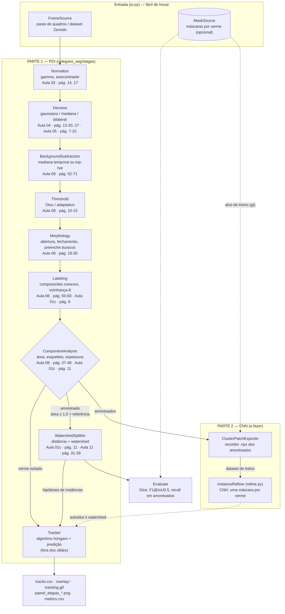
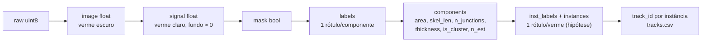

# Segmentação e rastreamento de *C. elegans* — PDI + CNN

Repositório: <https://github.com/Nixxye/PDI-C.Elegans>

Protótipo para o dataset do WormSwin ([Zenodo 7456803](https://zenodo.org/records/7456803), CC BY 4.0: `csb-1_dataset.zip`, `synthetic_images_dataset.zip`, `md_dataset.zip`).
Objetivo: **traçar cada verme individualmente ao longo dos quadros**, em duas partes:

| Parte | O que faz | Estado |
|---|---|---|
| **1. PDI** (este código) | Segmenta, separa o que dá por métodos clássicos, rastreia, e **entrega recortes dos amontoados** para a CNN | implementada |
| **2. CNN** (`celegans_seg/cnn.py`) | Separa os vermes dentro de cada amontoado (uma máscara por verme) | implementada (ver limitações) |

> Convenção de citação: `[Aula NN, pág. P]` = página **P do PDF** (índice da página no arquivo, não o número impresso no slide) da aula NN em `Estudos/PDI/Slides`. Está nos docstrings de cada função.

## Como rodar

```bash
pip install -r requirements.txt

# 1) sem dados reais: gera uma sequência sintética no mesmo formato do Zenodo
python tools/make_synthetic.py --out data/synthetic --seq seq0
python run_pdi.py --dataset-root data/synthetic --seq seq0 --out runs/synth

# 2) com o dataset real (descompactado em qualquer lugar)
python run_pdi.py --dataset-root D:/zenodo/csb-1_dataset --seq 24_2_1_1 --out runs/csb1
python run_pdi.py --images D:/outra/pasta/de/frames --out runs/meu_video     # sem gabarito

python -m unittest discover -s tests
```

**Trocar a entrada** não exige mexer no código: `--images <pasta>` (qualquer pasta de quadros), ou `--dataset-root` + `--seq`, ou os campos `input.*` do `config.yaml`. Qualquer parâmetro pode ser mudado por `--set secao.campo=valor` (ex.: `--set threshold.method=adaptive --set input.step=2`). Para vídeo (.avi/.mp4) basta criar outra `FrameSource` em `io.py` (3 métodos).

> Ajuste o `input.pattern`/`input.mask_pattern` se os nomes no seu download forem diferentes. O layout assumido (`images/<seq>/<k>.png`, `masks/<seq>/<k>_<i>.png`, uma máscara por verme) vem do protótipo anterior em `Estudos/PDI/Trabalho`; a página do Zenodo **não** descreve a estrutura interna dos zips, então confira ao descompactar.

### Ver o pipeline passo a passo

```bash
python tools/step_viewer.py --dataset-root data/csb-1_extracted/csb-1_dataset --seq 24_2_1_1 --frame 59
python tools/step_viewer.py --dataset-root data/csb-1_extracted/csb-1_dataset --seq 24_2_1_1 --zoom 20,200,180,500   # começa com zoom (y0,y1,x0,x1)
python tools/step_viewer.py ... --save etapas.png                                                                     # só grava o PNG, sem janela
```

Abre uma janela com 12 painéis (original, normalizado, suavizado, sinal pós-fundo, limiar, morfologia, rótulos, distância, marcadores, watershed, resultado e gabarito). Os eixos são compartilhados: o zoom da barra do matplotlib vale para todos os painéis. Setas ←/→ mudam de quadro (±1), ↑/↓ (±10), ou use o slider; `q` sai. O rastreamento fica fora porque depende dos quadros anteriores.

## CNN: separar os vermes de um amontoado (Parte 2)

Tudo da rede está em **um arquivo**, [`celegans_seg/cnn.py`](celegans_seg/cnn.py) (precisa de `torch`; o resto do projeto roda sem ele).

```bash
python tools/build_cnn_dataset.py --patch-size 192 --out data/cnn_patches192   # 1) recortes dos amontoados, com gabarito
python tools/train_cnn.py --patches data/cnn_patches192/cnn_dataset            # 2) treina -> models/cluster_cnn.pt (~12 min na RTX 5070 Ti)
python tools/cnn_check.py --patches data/cnn_patches192/cnn_dataset            # 3) CNN x watershed x gabarito, recorte a recorte -> runs/cnn_check/*.png
python run_pdi.py --dataset-root ... --seq 24_2_1_1 --set refine.kind=cnn      # 4) no pipeline completo (overlay, tracks.csv, métricas)
python tools/step_viewer.py ... --set refine.kind=cnn                          # 5) os painéis 9 e 10 mostram o que a CNN separou
```

**Entradas** (recorte 192×192 centrado no amontoado, 3 canais, `patch_to_input`): (0) **imagem** em cinza, `(x/255 − 0,58)/0,2`; (1) **sinal pós-fundo** (o do passo 4 do pipeline, com o ganho do limiar), `/255`; (2) **máscara do amontoado**, binária. A distância, o esqueleto, a proposta do watershed e a estimativa de contagem (`n_est`) são gravados nos `.npz` mas **não** entram na rede. **Saída**: 6 máscaras ("slots", uma por verme, podem se sobrepor) e uma probabilidade de existência por slot; só conta o que está dentro da máscara do amontoado.

**Como funciona.** U-Net de 4 níveis com contexto global (2,1 M de parâmetros; pesos de ~9 MB em `models/cluster_cnn.pt`). A ordem dos slots não importa: no treino cada verme do gabarito é casado com o slot mais parecido (algoritmo húngaro sobre o Dice) e só esses pares levam a perda de máscara (BCE + Dice); a existência de cada slot é aprendida à parte (BCE). Dentro do pipeline, o estágio `refine` (`CNNRefiner`) troca cada instância `cluster` pelas instâncias `cnn` (marcadas `ambiguous`; no overlay o rótulo leva um `c`, ex.: `19c`).

**Por que o treino usa amontoados sintéticos.** Só ~13 % dos recortes reais têm 3+ vermes (74 % têm 2) e a rede aprendia a devolver sempre 2. O treino fabrica, em metade das amostras, amontoados maiores colando 1 a 3 vermes de outros recortes (com a máscara exata) sobre o recorte, de modo que encostem no amontoado (`--synth 0.5`). Foi o que mais ajudou: ver a tabela do histórico.

**Dados.** Recortes gerados pelo próprio pipeline (amontoados que ele detecta) com as máscaras por verme do CSB-1 restritas à máscara do amontoado. Treino: 7 sequências (~1.050 recortes); validação: `24_1_1_2` (escolhe a melhor época); **teste: `24_2_1_1`**, fora do treino e da validação.

**Resultados na sequência de teste** (574 recortes de amontoado, 1.291 vermes; F1 por verme a IoU ≥ 0,5; `tools/cnn_check.py`):

| Método | F1 | Contagem de vermes certa |
|---|---|---|
| Watershed por distância | 0,69 | 0,78 |
| **CNN** | **0,93** | 0,84 |

No pipeline completo (passo 2), sem e com `refine.kind=cnn`: F1 por instância 0,74 → **0,90**, recall 0,75 → **0,97**, precisão 0,74 → 0,85, recall dentro de amontoados 0,05 → **0,91**, `f1_in_cluster` 0 → **0,66**; IDs de trilha distintos 63 → 52.

Matriz de contagem no teste (linha = vermes no gabarito; entre parênteses, o previsto): **1** → 2 em 35 de 38 (ruim); **2** → 2 em 407 de 427; **3** → 3 em 64 de 70; **4** → 4 em 6 de 15 (3 em 2, 5 em 7); **5+** → 5 em 15 de 24 (4 em 9).

**Histórico do que foi tentado** (F1 no teste; para não repetir):

| Versão | F1 | Problema / achado |
|---|---|---|
| U-Net de 3 níveis (campo de visão ~60 px) | 0,75 | devolvia **sempre 2** vermes |
| 4 níveis + contexto global + amostragem balanceada | 0,82 | 2 ou 3; nunca 4+ |
| + cabeça de existência por slot, amostragem balanceada | 0,66 | inventava um 3º verme (155 de 427 amontoados de 2); variar o limiar de existência não resolveu (máx. 0,71) |
| idem, perda de máscara mais forte, amostragem uniforme | 0,80 | melhorou o caso de 1 verme (9 de 38), piorou o de 3 (17 de 70) |
| **+ amontoados sintéticos (colagem)** | **0,93** | chega a prever 4 e 5 vermes |
| mesma receita, **sem `24_2_1_2` no treino** (gravação vizinha da de teste) | 0,94 | descarta a suspeita de vazamento entre as duas sequências |

Usar a estimativa de contagem pela área (`n_est`) para escolher quantos slots manter também foi testado e não ajudou: acerta 90 % no teste, mas só 29 % em `24_1_1_2`.

**Limitações (leia antes de confiar).**
- **Amontoados de 1 verme saem divididos em 2** (35 de 38 no teste); eles existem porque a área passa de 1,5× a de um verme (verme grande, enrolado ou com sujeira junto).
- **`24_1_1_2` não generaliza**: lá a CNN tem F1 0,81 (watershed 0,64), mas acerta a contagem em só 29 % dos recortes e devolve 2 para quase todo amontoado de 3-4 vermes. **Não investiguei a causa** (talvez o tamanho/aparência dos vermes ou o gabarito dessa sequência). Como o teste é uma sequência só, o 0,93 pode ser otimista.
- Emaranhados de 4+ vermes ainda erram bastante (6 de 15 certos entre os de 4); vermes paralelos colados e o verme enrolado sobre si também falham (`runs/cnn_check/24_2_1_1_piores.png`).
- Amontoados maiores que o recorte (192 px) ficam como estão (`cluster`).
- A identidade dentro do amontoado continua pouco confiável no rastreamento (trilhas bagunçadas dentro dele).

### Informação temporal (quadro anterior): testada, **não** ficou como padrão

Ideia: dar à rede o que o sistema viu no quadro anterior, quando os vermes de um amontoado costumam estar separados. Implementado em duas formas (as duas desligadas por padrão):
- **Entrada com 5 canais** (`python tools/train_cnn.py --temporal --out models/cluster_cnn_temporal.pt`, dados de `build_cnn_dataset.py`, que agora grava `prev_gt`): os 3 de sempre + (3) a união das máscaras dos vermes do quadro anterior que encostam no amontoado (dilatado 10 px) + (4) a contagem desses vermes ÷ 6. Sem quadro anterior os dois canais vão zerados (e o treino faz isso em 20 % das amostras e erra a contagem em outros 20 %). Nos amontoados sintéticos, o verme colado entra no quadro anterior deslocado de até 3 px.
- **Dica de contagem na saída** (`--set refine.use_prev_count=true`): em vez de cortar os canais por um limiar de existência, mantém os **n canais mais prováveis**, n = nº de vermes do quadro anterior (um amontoado que já era amontoado vale `n_est`). Funciona também com os pesos de 3 canais.
- O estágio `refine` guarda a saída do quadro anterior (só usa se for o quadro imediatamente anterior da sequência).

| Teste no recorte, **prev = gabarito** (limite superior), `24_2_1_1` | F1 | Contagem certa |
|---|---|---|
| 3 canais, limiar de existência (padrão) | 0,928 | 0,84 |
| 3 canais + n do quadro anterior | 0,932 | 0,92 |
| 5 canais, limiar de existência | 0,931 | 0,83 |
| 5 canais + n do quadro anterior | 0,941 | 0,93 |

| Pipeline completo, **prev = saída do sistema**, `24_2_1_1` | F1 | recall | `cluster_recall` | `f1_in_cluster` |
|---|---|---|---|---|
| **referência: 3 canais, sem dica (padrão)** | **0,902** | 0,971 | 0,907 | **0,658** |
| 5 canais | 0,892 | 0,958 | 0,857 | 0,622 |
| 5 canais + n do quadro anterior | 0,894 | 0,966 | 0,881 | 0,632 |
| 3 canais + n do quadro anterior | 0,893 | 0,973 | 0,912 | 0,624 |

O que aprendi: (1) o nº de vermes do quadro anterior é muito informativo (bate com o real em 91 % dos recortes quando vem do gabarito), mas **a rede de 5 canais quase não o usa**: o ganho veio da dica aplicada na saída; (2) mesmo no limite superior o ganho é pequeno (+0,013 de F1); (3) no pipeline real o nº vindo da saída do sistema bate com o real em só **78 %** (primeiros 120 quadros da sequência de teste), principalmente por **excesso**: amontoados de 2 vermes com prev_n = 3, 4 ou 6 (amontoado anterior não separado vale `n_est`; vizinhos dentro da janela de 10 px), e uma contagem errada para cima acrescenta um verme falso, o que derruba a precisão. **Não** implementei a versão de um canal por verme (slot *k* = mesmo verme do quadro anterior): ela dependeria da mesma saída ruidosa e o teto de ganho em contagem/F1 é pequeno; seria útil sobretudo para a identidade dentro do amontoado, que não é medida aqui.

## Datasets e origem

Ambos são **CC BY 4.0** (citar ao usar). Os dados ficam em `data/` (ignorada pelo git).

| Dataset | Origem | O que é | Como entra no projeto |
|---|---|---|---|
| **CSB-1** (WormSwin) | [Zenodo 7456803](https://doi.org/10.5281/zenodo.7456803) — Deserno & Bozek, 2023; artigo: *WormSwin: instance segmentation of C. elegans using vision transformer*, Sci. Rep. | **Vídeo** de placa (912×736, cinza gravado como RGB), uma máscara por verme, com sobreposição | Direto: `--dataset-root data/csb-1_extracted/csb-1_dataset --seq <seq>`. Único com continuidade temporal, logo o único para rastreamento |
| **Annotated images** | [Zenodo 15526615](https://doi.org/10.5281/zenodo.15526615) — Weheliye, Rodriguez, Feriani, Javer, Uhlmann & Brown, 2025; artigo: *A neural network model enables worm tracking in challenging conditions…*, PLOS Comput. Biol. 21(8): e1013345 | **Recortes independentes** (33–350 px) com 1–6 vermes; contorno e esqueleto por verme | Via conversor `tools/convert_annotated_images.py` (abaixo). Bom para a **CNN de separação** e para avaliar a segmentação; sem rastreamento |

Só o arquivo `Annotated_images.zip` (1,6 GB) do registro 15526615 é usado; os demais (`DT_C`, `PAF`, `Omnipose`, `Figures_Code`, 38,9 GB no total) são modelos e código do artigo.

### Annotated images: conversão e uso

O zip contém 13 arquivos `<fonte>_<split>.p.zip` que, na verdade, são **GZIP de pickles** (fontes: `manual`, `manual-v2`, `from_NNv1`, `from_tierpsy`). Como pickle pode executar código, o conversor usa um desserializador que só aceita as classes do NumPy presentes nesses arquivos e recusa o resto.

```bash
# extrair o zip numa pasta própria (data/annotated_raw) e converter os conjuntos de teste
python -I tools/convert_annotated_images.py --src data/annotated_raw/Annotated_images \
    --out data/annotated_converted --only manual-v2_test manual_test from_NNv1_test from_tierpsy_test --skeletons

# segmentar (recortes independentes: fundo por top-hat, moldura preta ignorada, sem rastreador)
python run_pdi.py --dataset-root data/annotated_converted --seq manual-v2_test --out runs/ann_manual-v2_test \
    --set background.method=tophat --set input.nodata_border=true \
    --set "stages=[normalize,denoise,background,threshold,morphology,labeling,analysis,split,refine,evaluate,export,visualize]"
```

Detalhes e ressalvas do conversor:
- Cada amostra: imagem em cinza, larguras (49 pts), esqueleto (49 pts) e contorno (98 pts) por verme. As **máscaras são o contorno preenchido** (uma por verme, sobreposição preservada). A ordem dos eixos do contorno é detectada automaticamente (contraste local) e foi conferida visualmente nos 4 conjuntos.
- `from_NNv1_*` **não traz contorno**: as máscaras são **reconstruídas** do esqueleto + largura (IoU médio ≈ 0,88 contra o contorno anotado, medido em `manual-v2_test`, que tem os dois). Tratar como gabarito aproximado.
- Não convertidos ainda: os `*_train`/`*_validation` (o `from_tierpsy_train` tem 1,2 GB compactado) e `from_tierpsy_negative` (formato diferente, recortes sem vermes). Basta incluí-los em `--only` (menos o `negative`).
- `input.nodata_border=true`: os recortes têm moldura preta (valor 0) que é **mais escura que o verme** e virava falso positivo; regiões de valor 0 ligadas à borda passam a ser "sem dado".

Resultado nos conjuntos de **teste** (pipeline de PDI, sem CNN; média por recorte, F1 por verme a IoU ≥ 0,5):

| Conjunto | vermes/recorte | F1 | recall em amontoados |
|---|---|---|---|
| `from_tierpsy_test` (1 verme, recortes fáceis) | 1,0 | 0,93 | 0,79 |
| `from_NNv1_test` (máscara reconstruída) | 1,65 | 0,71 | 0,52 |
| `manual_test` | 1,3 | 0,52 | 0,44 |
| `manual-v2_test` (mais sobreposição) | 2,1 | 0,44 | 0,24 |

O padrão é o esperado: o PDI vai bem em verme isolado e piora conforme aumenta a sobreposição, que é o que a CNN deve resolver. Atenção: parâmetros em pixels (`min_area`, `marker_min_dist`) foram deixados nos valores do CSB-1, e a escala dos recortes varia muito (de 33 a 350 px), então há margem para ajuste por conjunto.

## Arquitetura (pipeline de estágios)



Os estágios são classes com a mesma interface (`Stage.process(ctx)`, `core.py`). O `FrameContext` carrega o quadro e o que cada estágio produz (`image → signal → mask → labels → components → inst_labels → instances`). Estágios que precisam ver a sequência (fundo por mediana, área de referência de um verme) implementam `fit()`, que recebe quadros de amostra já processados pelos estágios anteriores. **Ordem, inclusão e remoção de estágios vêm de `stages:` no `config.yaml`**; um estágio novo é uma classe + uma linha em `stages/__init__.py`.

### O que cada estágio entrega



## Mapa slide → código

| Técnica | Slide | Onde |
|---|---|---|
| Gamma `s = c·rᵞ`, autocontraste | Aula 03, pág. 14, 17, 23-24 | `ops.gamma_correct`, `ops.autocontrast` |
| Vizinhança-8; distância (`bwdist`) | Aula 01c, pág. 9 e 11 | `ops.STRUCT_8`, `ops.distance_transform` |
| Gaussiano; mediana | Aula 04, pág. 13-20; 27-28 | `ops.gaussian`, `ops.median` |
| Filtro bilateral | Aula 05, pág. 7-15 | `ops.bilateral` |
| Otsu; limiar adaptativo | Aula 08, pág. 10-13; 14-15 | `ops.otsu_threshold`, `ops.local_mean_threshold` |
| Dilatação, erosão, abertura, fechamento | Aula 08, pág. 19-35 | `ops.opening`, `ops.closing` |
| Top-hat (iluminação) | Aula 08, pág. 62-71 | `ops.black_tophat`, `BackgroundSubtraction` |
| Esqueletização por afinamento | Aula 08, pág. 37-48 | `ops.thin` (Zhang-Suen), `ops.skeleton_stats` |
| Rotulagem em duas passadas | Aula 08, pág. 50-60 | `ops.two_pass_labeling` (didática, validada contra SciPy nos testes), `ops.label_components` |
| Watershed | Aula 11, pág. 31-39 | `stages/split.py` |
| RGB → cinza (0,299R+0,587G+0,114B) | Aula 10, pág. 2 | `io.to_gray_u8` |
| Pseudocolorização de rótulos | Aula 10, pág. 29 | `stages/viz.py` |
| Homomórfico (alternativa ao top-hat) | Aula 07, pág. 56-64 | não implementado |

Fora dos slides (e marcado assim no código): mediana temporal de fundo, rastreador húngaro, métricas Dice/F1.

## Saídas (`runs/<nome>/`)

| Arquivo | Conteúdo |
|---|---|
| `tracks.csv` | `frame, track_id, y, x, state, area, ambiguous` — trajetória de cada verme (`state=occluded`: trilha mantida por predição dentro de um amontoado) |
| `overlay/*.png`, `tracking.gif` | contorno + ID + rastro; contorno grosso = veio de amontoado (identidade menos confiável) |
| `painel_etapas_*.png` | resultado de cada etapa lado a lado (primeiro quadro + primeiros quadros com amontoado) — material para o relatório |
| `metrics.csv` | por quadro: Dice semântico, precisão/recall/F1@IoU 0,5, recall dos vermes que estão em amontoados |
| `cluster_masks/<quadro>.png` | **máscara binária dos amontoados** (255 = região onde há vários vermes colados/cruzados), um PNG por quadro |
| `cnn_dataset/<seq>/*.npz`, `index.csv` | **entrega para a CNN** (abaixo) |

> **Amontoados não são separados por padrão** (`split.enabled: false` no `config.yaml`): cada amontoado vira uma única região marcada como `source="cluster"` (contorno vermelho nas imagens), fica fora do rastreamento (os vermes que somem nele ficam `occluded`) e é entregue à CNN. Para voltar a tentar o watershed: `--set split.enabled=true`.
>
> Métricas que não exigem separar o amontoado: `f1_single` (vermes isolados previstos × vermes do gabarito fora de amontoados) e `cluster_dice` (máscara de amontoados prevista × a do gabarito, onde amontoado = componente conexo do gabarito com ≥ 2 vermes). No CSB-1 `24_2_1_1` (passo 2, com `background.percentile: 70`): `f1_single` ≈ 0,85 e `cluster_dice` ≈ 0,74 (com a mediana pura, 50, eram ≈ 0,67 e ≈ 0,55).

## Entrega para a CNN (Parte 1 → Parte 2)

Cada amontoado vira um recorte `patch_size × patch_size` (padrão 128) centrado nele, com:
`image`, `signal`, `mask` (só aquele componente), `dist`, `skeleton`, `ws_labels` (proposta do watershed), `meta` (frame, bbox, `n_est`, `fits`) e, havendo gabarito, **`gt`: pilha (N, S, S) com uma máscara por verme, sobreposição preservada** (o alvo de treino). `ws_labels`, `dist` e `skeleton` são entradas auxiliares opcionais, o que permite ablação "CNN pura vs. CNN + informação clássica".

Para plugar a rede: subclasse de `InstanceRefiner` (`stages/refine.py`), implementar `refine_patch(patch) -> mapa de rótulos`, e `refine.kind` no config. O resto (rastreador, avaliação, visualização) não muda.

## Resultado de referência e limitações (honestas)

Na sequência sintética (`tools/make_synthetic.py`, 8 vermes em 320×320, 60 quadros): Dice semântico ≈ 0,88, mas F1@0,5 por instância ≈ 0,70 e **só ≈ 34 % dos vermes dentro de amontoados são recuperados** — exatamente o buraco que a CNN deve preencher. 

No **CSB-1 real**, sequência `24_2_1_1` (passo 2, 233 quadros, ~20 vermes/quadro): Dice semântico ≈ 0,77, precisão ≈ 0,63, recall ≈ 0,69, F1@0,5 ≈ 0,66, recall em amontoados ≈ 0,54; 278 recortes de amontoados exportados. Observações: (1) o fundo por mediana precisa ser estimado sobre a sequência inteira — com só 60 quadros consecutivos os vermes quase não se movem, entram no fundo e o F1 caiu para ≈ 0,07; (2) `labeling.min_area=150` foi escolhido numa varredura pequena **nesta mesma sequência**, então o número é otimista; (3) os IDs de trilha chegam a 40+ numa sequência com ~20 vermes: o rastreador fragmenta trilhas (vermes não detectados em alguns quadros, trocas em amontoados) e ainda precisa de ajuste.

- **Watershed por distância falha em vermes cruzados/paralelos colados** (não há "pescoço" na máscara). Por isso as instâncias vindas de amontoado são marcadas `ambiguous`.
- **Detecção de amontoado por área**: sobreposição reduz a área visível; a área de referência é a mediana dos componentes das amostras — se quase tudo for amontoado, ela fica inflada. Pode-se fixá-la com `analysis.ref_area`.
- **Verme (ou parte dele) parado entra no fundo da mediana** e some, o que **parte um verme em dois** (o trecho do meio que fica parado vira fundo). Medido no CSB-1 (gabarito): 2,3 % dos vermes isolados saíam partidos nas 9 sequências sem a de teste. Usar um percentil mais alto como fundo (`background.percentile: 70`, padrão) reduziu para 0,6 % e subiu o Dice médio de 0,75 para 0,80; percentis ≥ 80 pioram uma das sequências (`24_1_0_2`, falsos positivos). Alternativa: `background.method=tophat`.
  Sobram cortes (≈ 0,6 % dos vermes). Testado: **fechamento em tons de cinza do sinal** (`background.close_kind=disk|lines|gauss`) resolve em sequências limpas, mas em `24_1_0_2` (agá cheio de riscos escuros) funde a sujeira em blocos (amontoados por quadro 0,5 → 7-8), então fica desligado. O que ficou ligado é `labeling.bridge_gap: 8`: liga com um traço os pedaços **grandes** (≥ `bridge_min_area`) a no máximo 8 px (partidos 0,6 % → 0,1 %), ao custo de transformar vermes próximos em amontoado (F1 do teste 0,77 → 0,73; `f1_single` 0,85 → 0,83). Desligue com `--set labeling.bridge_gap=0`.
  **Corpo/cauda incompleto** (o defeito mais frequente: no CSB-1 `24_2_1_1`, 22 % dos vermes isolados ficavam com < 80 % do gabarito coberto; 14 % nas sequências de treino): o fundo temporal também absorve a parte do verme que fica parada, então o sinal do corpo/cauda sai fraco mesmo com o verme escuro na imagem. `threshold.grow_dist: 15` (padrão) usa a máscara temporal como semente (≥ `grow_seed_area` px) e a completa com o sinal espacial (top-hat) até 15 px dela, com o mesmo limiar do sinal temporal (`grow_thr: 1.0`). Resultado: cobertura < 80 % cai para ≈ 5 % (teste e treino); no teste, Dice 0,85 → 0,84 e `f1_single` 0,83 → 0,85. Custo: nas sequências com muita sujeira (`24_1_0_2`, `24_0_0_3`) o Dice cai de 0,76 → 0,65 e de 0,84 → 0,77 (sujeira junto do verme entra na máscara), e o pipeline fica ≈ 60 % mais lento (top-hat 31×31 por quadro). Usar o top-hat sozinho (`background.method=tophat`) é pior (Dice 0,49 no treino).
  O top-hat também marca como "escuro" pedaços da textura do ágar encostados no verme, que entravam como **espinhos** na máscara (aparecem em laranja no painel 5 do `step_viewer`). `threshold.grow_open: 3` (padrão) faz uma abertura de raio 3 só no trecho acrescentado: espinhos finos somem, a cauda (largura de verme) fica. Com isso (5 sequências de treino): Dice 0,78 → 0,80, `f1_single` 0,69 → 0,71; teste: Dice 0,85, `f1_single` 0,85, cobertura < 80 % em 6,6 % dos vermes (era 22 % sem o crescimento). Desligue com `--set threshold.grow_dist=0`.
  Obs.: o painel "4. sinal" do `step_viewer` mostra só o sinal temporal (cauda fraca); a máscara completa aparece nos painéis 5 e 6.
- **Rastreamento**: ID persiste fora de colisões; dentro delas a trilha é mantida por predição e pode trocar de identidade ao sair. Resolver isso bem é o papel da CNN + informação temporal.
- Parâmetros em pixels (`marker_min_dist`, `min_area`, `tophat_size`) foram calibrados no sintético; **revise-os com a resolução real do CSB-1 (912×736)**.
- Mediana temporal pressupõe câmera e placa estáticas.

## Estrutura

```
celegans-seg/
├── run_pdi.py            # CLI da parte 1
├── config.yaml           # entrada, parâmetros e ordem dos estágios
├── celegans_seg/
│   ├── config.py         # dataclasses + YAML + --set
│   ├── core.py           # Stage, FrameContext, Pipeline (fit/process/finish)
│   ├── io.py             # FrameSource, ImageFolderSource, MaskSource
│   ├── ops.py            # operações de PDI à mão, com citação dos slides
│   └── stages/           # preprocess, segment, analysis, split, refine, tracking,
│                         # evaluate, export, viz   (+ REGISTRY em __init__.py)
├── tools/make_synthetic.py   # sequência sintética com gabarito
└── tests/test_pipeline.py
```
