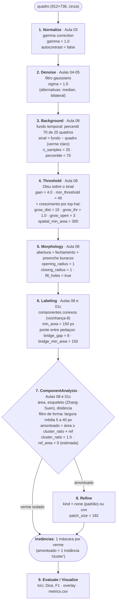

# Segmentação de *C. elegans* — PDI clássico (+ gancho para uma CNN)

Repositório: <https://github.com/Nixxye/PDI-C.Elegans>

Dado um quadro de uma placa com vários *C. elegans*, o programa **separa os vermes do fundo** e marca os **amontoados** (vermes que se tocam ou se cruzam). Este repositório contém:

1. **PDI clássico** (técnicas da disciplina): tudo o que está descrito abaixo, pronto e avaliado.
2. **Esqueleto da CNN** (`celegans_seg/cnn.py`): só a interface. A rede que separa os vermes dentro de cada amontoado fica a cargo do colega; ver [A CNN (a fazer)](#a-cnn-a-fazer).

Dados: dataset do WormSwin, CSB-1 ([Zenodo 7456803](https://zenodo.org/records/7456803), CC BY 4.0). Mais detalhes em [`docs/DADOS.md`](docs/DADOS.md).

## Resultado do PDI

Relatório `tools/pdi_report.py` (todas as sequências do CSB-1, 1 quadro a cada 10, gabarito com duplicatas fundidas):

| | |
|---|---|
| Vermes do gabarito encontrados | 100 % |
| Máscara dos vermes isolados com IoU ≥ 0,5 | 99,9 % |
| Falsos positivos | 0 (os componentes sem gabarito são vermes cortados pela borda, vermes não anotados ou "vermes pequenos" por definição) |

Os números exatos saem do relatório (`runs/pdi_report/relatorio.md`); rode de novo para reproduzi-los.

## Como rodar

```bash
pip install -r requirements.txt

# sem dados reais: gera uma sequência sintética com gabarito
python tools/make_synthetic.py --out data/synthetic --seq seq0
python run_pdi.py --dataset-root data/synthetic --seq seq0 --out runs/synth

# com o CSB-1 (descompactado em data/csb-1_extracted/csb-1_dataset)
python run_pdi.py --dataset-root data/csb-1_extracted/csb-1_dataset --seq 24_2_1_1 --out runs/csb1
python run_pdi.py --images <pasta com quadros> --out runs/meu_video   # qualquer pasta de quadros, sem gabarito

python -m unittest discover -s tests
```

Qualquer parâmetro do `config.yaml` muda na linha de comando com `--set secao.campo=valor` (ex.: `--set threshold.method=adaptive --set input.step=2`).

### Avaliar o PDI (relatório)

```bash
python tools/pdi_report.py                       # todas as sequências, 1 quadro a cada 10 -> runs/pdi_report/relatorio.md
python tools/pdi_report.py --seq 24_2_1_1 --step 2
```

Relatório com % de vermes encontrados, taxa de acerto da máscara dos vermes isolados (IoU ≥ 0,5), nº de componentes isolados × amontoados, amontoados não detectados e **falsos positivos dos dois tipos** (isolado e amontoado), geral e por sequência. Grava também `falsos_positivos.csv`, imprime comandos do visualizador para abrir os maiores de cada tipo e **gera uma galeria com uma imagem por falso positivo** (`galeria/*.png` e `galeria.html`; `--galeria-categorias fp borda verme pequeno` inclui as outras categorias, `--no-galeria` desliga). Funde as máscaras **duplicadas** do gabarito (ver `docs/DADOS.md`); `--no-dedup` mostra os números crus.

### Ver o pipeline passo a passo

```bash
python tools/step_viewer.py --dataset-root data/csb-1_extracted/csb-1_dataset --seq 24_2_1_1 --frame 59
python tools/step_viewer.py ... --seq 24_2_1_1 --fp        # abre no primeiro quadro com falso positivo, já com zoom nele
```

Abre uma janela com 12 painéis (um por etapa, mais o gabarito) e eixos compartilhados. Setas ←/→ trocam de quadro (±1), ↑/↓ (±10) ou use o slider; `f` pula para o próximo quadro com falso positivo; `q` sai. `--save etapas.png` só grava a figura; `--zoom y0,y1,x0,x1` começa com zoom.

**Falsos positivos** (precisa do gabarito): componentes com menos de 30 % da área sobre um verme do gabarito, **que não encostam na borda e não têm forma de verme** (o gabarito não anota vermes cortados pela borda e esquece alguns vermes inteiros). **Tipo 1, isolado**: magenta com rótulo FP. **Tipo 2, amontoado**: vermelho com rótulo "FP amontoado". Os que encostam na borda, têm forma de verme ou são "verme pequeno" (≥ 150 px e contraste ≥ 0,1; ver `docs/EXPERIMENTOS.md`) ganham só um rótulo ciano e **não** contam como falso positivo. A "forma de verme" é uma regra heurística de área, largura e contraste (`evaluate.classify_no_gt`), não um detector.

## Como funciona

Cada bloco mostra a técnica e os parâmetros padrão do `config.yaml` (mudam com `--set secao.campo=valor`).



| Estágio | O que faz | Slide | Código |
|---|---|---|---|
| Normalize | gamma, autocontraste | Aula 03 | `ops.gamma_correct`, `ops.autocontrast` |
| Denoise | gaussiano (padrão), mediana, bilateral | Aulas 04 e 05 | `ops.gaussian`, `ops.median`, `ops.bilateral` |
| Background | `sinal = fundo − quadro` (fundo = percentil 70 de ~25 quadros); top-hat | Aula 08 (top-hat) | `stages/preprocess.py`, `ops.black_tophat` |
| Threshold | Otsu (ou adaptativo) + top-hat para completar a cauda e achar vermes parados | Aula 08 | `ops.otsu_threshold`, `stages/segment.py` |
| Morphology | abertura, fechamento, preenche buracos | Aula 08 | `ops.opening`, `ops.closing` |
| Labeling | componentes conexos (vizinhança-8) + liga pedaços de verme partido | Aulas 08 e 01c | `ops.label_components` (e `two_pass_labeling`, a versão didática dos slides) |
| ComponentAnalysis | área, esqueleto, espessura; **amontoado = área ≥ 1,5 × a de um verme**; descarta o que não tem forma de verme (largura média < 5 px = sujeira, > 40 px = mancha) | Aulas 08 e 01c | `stages/analysis.py`, `ops.thin`, `ops.distance_transform` |
| Instances | cada componente vira uma instância (`single` ou `cluster`) | — | `stages/instances.py` |
| Refine | `none` (padrão) ou `cnn` (gancho) | — | `stages/refine.py`, `celegans_seg/cnn.py` |
| Evaluate / Export / Visualize | métricas, recortes de amontoados, imagens | — | `stages/evaluate.py`, `export.py`, `viz.py` |

Convenção de citação nos docstrings: `[Aula NN, pág. P]` = página **P do PDF** da aula NN. O que cada aula contribui está em [`CONTEUDO_UTILIZADO.md`](CONTEUDO_UTILIZADO.md). Fora dos slides: fundo temporal, ponte/crescimento da máscara, filtro de forma, métricas Dice/IoU.

Os estágios têm a mesma interface (`Stage.process(ctx)`, em `core.py`) e **a ordem vem de `stages:` no `config.yaml`**; um estágio novo é uma classe mais uma linha em `stages/__init__.py`. O `FrameContext` carrega o que cada estágio produz: `image → signal → mask → labels → components → inst_labels → instances`.

## A CNN (a fazer)

O PDI entrega cada amontoado como **uma instância `source="cluster"`**. A rede deve devolver uma máscara por verme. Toda a cola já existe; falta só implementar dois métodos em [`celegans_seg/cnn.py`](celegans_seg/cnn.py):

- `ClusterSeparator.predict_masks(patch)`: recebe o recorte e devolve uma lista de máscaras booleanas (uma por verme).
- `train(patches, out_path, val_patches)`: treina e grava os pesos em `refine.weights`.

O recorte (`patch`) é um dict de arrays S×S (S = `export.patch_size` = 192, centrado no amontoado): `image` (uint8, quadro original), `signal` (uint8, sinal pós-fundo) e `mask` (bool, só o amontoado); no treino há também `gt` (N, S, S), uma máscara por verme do gabarito.

```bash
python tools/build_cnn_dataset.py     # 1) recortes dos amontoados com gabarito -> data/cnn_patches/
python tools/train_cnn.py             # 2) treino (chama cnn.load_patches e cnn.train)
python run_pdi.py ... --set refine.kind=cnn   # 3) usa a rede no pipeline (CNNRefiner)
```

Já implementados em `cnn.py` (não dependem do modelo): `load_patches`, `targets_in_mask`, `match_scores` / `f1_from` (avaliação por IoU com algoritmo húngaro) e `ClusterSeparator.separate` (mapa de rótulos sem perder área). Cuidados com o gabarito (duplicatas, vermes cortados pela borda) estão em `docs/DADOS.md`. Uma versão anterior da CNN (U-Net) existe no histórico do git (commits `6d7095e` e `3ecc77f`).

## Saídas (`runs/<nome>/`)

| Arquivo | Conteúdo |
|---|---|
| `overlay/*.png`, `overlay.gif` | contorno de cada verme sobre o quadro; contorno grosso = veio de amontoado; vermelho = amontoado não separado |
| `metrics.csv` | por quadro: Dice, precisão/recall/F1 (se houver gabarito) |
| `painel_etapas_*.png` | resultado de cada etapa lado a lado |
| `cluster_masks/`, `cnn_dataset/` | só com o estágio `export` em `stages:` (ou use `tools/build_cnn_dataset.py`) |

## Limitações

- O fundo é temporal: supõe câmera e placa **estáticas**, e verme parado vira fundo (parcialmente corrigido; ver `docs/EXPERIMENTOS.md`).
- Os vermes dentro de um amontoado **não são separados** pelo PDI (só marcados); isso é papel da CNN.
- Amontoados maiores que o recorte (192 px) não poderiam ser enviados à CNN.
- Não há rastreamento: cada quadro é segmentado separadamente.

## Estrutura

```
PDI-C.Elegans/
├── run_pdi.py                 # roda o pipeline numa sequência
├── config.yaml                # entrada, parâmetros e ordem dos estágios
├── celegans_seg/
│   ├── config.py core.py io.py ops.py   # configuração, núcleo, entrada, operações de PDI (com citação dos slides)
│   ├── cnn.py                 # esqueleto da CNN (interface + avaliação)
│   └── stages/                # preprocess, segment, analysis, instances, refine, evaluate, export, viz
├── tools/                     # step_viewer, pdi_report, build_cnn_dataset, train_cnn, make_synthetic
├── tests/
├── docs/                      # EXPERIMENTOS.md, DADOS.md
└── CONTEUDO_UTILIZADO.md      # o que cada aula entrega ao projeto
```
