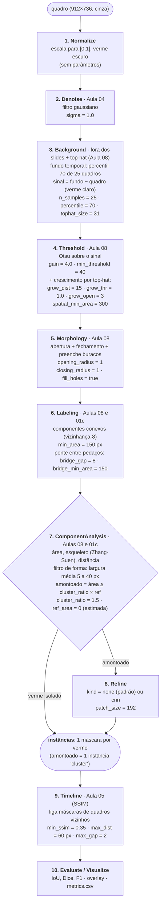

# Segmentação de *C. elegans* — PDI clássico + CNN (Mask R-CNN)

Repositório: <https://github.com/Nixxye/PDI-C.Elegans>

Dado um quadro de uma placa com vários *C. elegans*, o programa **separa os vermes do fundo** e marca os **amontoados** (vermes que se tocam ou se cruzam). Este repositório contém:

1. **PDI clássico** (técnicas da disciplina): tudo o que está descrito abaixo, pronto e avaliado.
2. **CNN** (Mask R-CNN do colega, em `cnn/`, intocada): separa os vermes dentro de cada amontoado que o PDI escolhe; ver [A CNN](#a-cnn).
3. **Linha do tempo** de cada verme (SSIM entre máscaras de quadros vizinhos) e um **player** para acompanhar a máscara de cada verme no vídeo; ver [Player](#player).

Dados: dataset do WormSwin, CSB-1 ([Zenodo 7456803](https://zenodo.org/records/7456803), CC BY 4.0). Mais detalhes em [`docs/DADOS.md`](docs/DADOS.md).

## Resultado do PDI

Relatório `tools/pdi_report.py` (todas as sequências do CSB-1, 1 quadro a cada 10, gabarito com duplicatas fundidas):

| | |
|---|---|
| Vermes do gabarito encontrados | 100 % |
| Máscara dos vermes isolados com IoU ≥ 0,5 | 99,9 % |
| Falsos positivos | 0 (os componentes sem gabarito são vermes cortados pela borda, vermes não anotados ou "vermes pequenos" por definição) |

Os números exatos saem do relatório (`runs/pdi_report/relatorio.md`); rode de novo para reproduzi-los.

## Como rodar

```bash
pip install -r requirements.txt

# sem dados reais: gera uma sequência sintética com gabarito
python tools/make_synthetic.py --out data/synthetic --seq seq0
python run_pdi.py --dataset-root data/synthetic --seq seq0 --out runs/synth

# com o CSB-1 (descompactado em data/csb-1_extracted/csb-1_dataset)
python run_pdi.py --dataset-root data/csb-1_extracted/csb-1_dataset --seq 24_2_1_1 --out runs/csb1
python run_pdi.py --images <pasta com quadros> --out runs/meu_video   # qualquer pasta de quadros, sem gabarito

python -m unittest discover -s tests
```

Qualquer parâmetro do `config.yaml` muda na linha de comando com `--set secao.campo=valor` (ex.: `--set threshold.min_threshold=30 --set input.step=2`).

### Avaliar o PDI (relatório)

```bash
python tools/pdi_report.py                       # todas as sequências, 1 quadro a cada 10 -> runs/pdi_report/relatorio.md
python tools/pdi_report.py --seq 24_2_1_1 --step 2
```

Relatório com % de vermes encontrados, taxa de acerto da máscara dos vermes isolados (IoU ≥ 0,5), nº de componentes isolados × amontoados, amontoados não detectados e **falsos positivos dos dois tipos** (isolado e amontoado), geral e por sequência. Grava também `falsos_positivos.csv`, imprime comandos do visualizador para abrir os maiores de cada tipo e **gera uma galeria com uma imagem por falso positivo** (`galeria/*.png` e `galeria.html`; `--galeria-categorias fp borda verme pequeno` inclui as outras categorias, `--no-galeria` desliga). Funde as máscaras **duplicadas** do gabarito (ver `docs/DADOS.md`); `--no-dedup` mostra os números crus.

### Ver o pipeline passo a passo

```bash
python tools/step_viewer.py --dataset-root data/csb-1_extracted/csb-1_dataset --seq 24_2_1_1 --frame 59
python tools/step_viewer.py ... --seq 24_2_1_1 --fp        # abre no primeiro quadro com falso positivo, já com zoom nele
```

Abre uma janela com 12 painéis (um por etapa, mais o gabarito) e eixos compartilhados. Setas ←/→ trocam de quadro (±1), ↑/↓ (±10) ou use o slider; `f` pula para o próximo quadro com falso positivo; `q` sai. `--save etapas.png` só grava a figura; `--zoom y0,y1,x0,x1` começa com zoom.

**Falsos positivos** (precisa do gabarito): componentes com menos de 30 % da área sobre um verme do gabarito, **que não encostam na borda e não têm forma de verme** (o gabarito não anota vermes cortados pela borda e esquece alguns vermes inteiros). **Tipo 1, isolado**: magenta com rótulo FP. **Tipo 2, amontoado**: vermelho com rótulo "FP amontoado". Os que encostam na borda, têm forma de verme ou são "verme pequeno" (≥ 150 px e contraste ≥ 0,1; ver `docs/EXPERIMENTOS.md`) ganham só um rótulo ciano e **não** contam como falso positivo. A "forma de verme" é uma regra heurística de área, largura e contraste (`evaluate.classify_no_gt`), não um detector.

## Como funciona

Cada bloco mostra a técnica e os parâmetros do `config.yaml` (mudam com `--set secao.campo=valor`). Todo parâmetro (PDI, linha do tempo, CNN e avaliação) está em `config.py` (padrão) e `config.yaml` (o que você edita). Os comentários no código são curtos de propósito: a origem de cada um (**slide**, **escolha nossa** ou **fora dos slides**) e como foi escolhido estão na tabela abaixo e em [`docs/ESTUDO_PDI.md`](docs/ESTUDO_PDI.md). Abaixo do diagrama, a tabela completa.



| Estágio | O que faz | Slide | Código |
|---|---|---|---|
| Normalize | escala para [0,1] (gamma e autocontraste da Aula 03 foram testados e **não entram**) | — | `stages/preprocess.py` |
| Denoise | passa-baixas gaussiano | Aula 04 (pág. 16-19) | `ops.gaussian` |
| Background | `sinal = fundo − quadro` (fundo = percentil 70 de 25 quadros, **fora dos slides**) + top-hat | Aula 08 (pág. 62-71, top-hat) | `stages/preprocess.py`, `ops.tophat` |
| Threshold | Otsu + top-hat para completar a cauda e achar vermes parados (**fora dos slides**) | Aula 08 (pág. 10-13) | `ops.otsu_threshold`, `stages/segment.py` |
| Morphology | abertura, fechamento, preenche buracos | Aula 08 | `ops.opening`, `ops.closing` |
| Labeling | componentes conexos (vizinhança-8) + liga pedaços de verme partido | Aulas 08 e 01c | `ops.label_components` (e `two_pass_labeling`, a versão didática dos slides) |
| ComponentAnalysis | área, esqueleto, espessura; **amontoado = área ≥ 1,5 × a de um verme**; descarta o que não tem forma de verme (largura média < 5 px = sujeira, > 40 px = mancha) | Aulas 08 e 01c | `stages/analysis.py`, `ops.thin`, `ops.distance_transform` |
| Instances | cada componente vira uma instância (`single` ou `cluster`) | — | `stages/instances.py` |
| Refine | `none` (padrão) ou `cnn` (gancho) | — | `stages/refine.py`, `celegans_seg/cnn.py` |
| Timeline | linha do tempo de cada verme: liga as máscaras de quadros vizinhos por SSIM (forma e sobreposição; MSE/PSNR no CSV), atribuição húngara, tolera 2 quadros sem aparecer; grava `timeline.csv`, `tracks.csv`, `timeline.png` | Aula 05 (pág. 17-22) | `stages/timeline.py`, `ops.ssim` |
| Evaluate / Export / Visualize | métricas, recortes de amontoados, imagens | — | `stages/evaluate.py`, `export.py`, `viz.py` |

### Parâmetros: o que é do slide e o que escolhemos

| Estágio | Parâmetro | Valor | Origem |
|---|---|---|---|
| Denoise | `sigma` | 1,0 | **escolha nossa** (a técnica e a regra do kernel 2⌈3σ⌉+1 são do slide) |
| Background | `percentile` | 70 | **escolha nossa** (fora dos slides; 50 = mediana) |
| Background | `n_samples` | 25 | **escolha nossa** |
| Background | `tophat_size` | 31 px | **escolha nossa** (SE quadrado; o slide usa circular) |
| Threshold | `gain` | 4,0 | **escolha nossa** |
| Threshold | `min_threshold` | 40 | **escolha nossa** (piso do Otsu) |
| Threshold | `grow_dist`, `grow_seed_area`, `grow_open`, `grow_thr`, `spatial_min_area` | 15, 150, 3, 1,0, 300 | **escolha nossa**, técnica **fora dos slides** |
| Morphology | `opening_radius`, `closing_radius` | 1, 1 | **escolha nossa** (abertura/fechamento são do slide) |
| Morphology | `fill_holes` | sim | **escolha nossa** |
| Labeling | `min_area` | 150 px | **escolha nossa** (rotulagem em vizinhança-8 é do slide) |
| Labeling | `bridge_gap`, `bridge_min_area` | 8, 150 | **escolha nossa**, técnica **fora dos slides** |
| Analysis | `cluster_ratio` | 1,5 | **escolha nossa**, critério **fora dos slides** |
| Analysis | `min_mean_width`, `max_mean_width` | 5, 40 px | **escolha nossa**, filtro **fora dos slides** |
| Timeline | `window`, `max_dist`, `min_ssim`, `dist_weight`, `max_gap` | 128, 60 px, 0,35, 0,3, 2 | **escolha nossa** (o SSIM é do slide; a ligação e o húngaro, não) |
| Refine/Export | `patch_size` | 192 px | **escolha nossa** |
| Analysis | `fallback_ref_area` | 400 px | **escolha nossa** (só se nenhum quadro de amostra tiver componente) |
| Timeline | `blur_sigma`, `roi_margin`, `ssim_sigma` | 1,0, 4 px, 1,5 | **escolha nossa**; `ssim_sigma` = **slide** (janela do SSIM de Wang et al.) |
| Refine | `score_thr`, `threshold`, `min_area`, `window_margin`, `max_window` | 0,3, 0,5, 20, 16, 448 | `score_thr` = o do colega; o resto **escolha nossa** |
| Evaluate | `iou_match`, `no_gt_fraction`, `border_margin`, `worm_*`, `small_*` | 0,5, 0,3, 2, … | **escolha nossa**, **fora dos slides** (só avaliação; não mudam a segmentação) |

A revisão de cada técnica contra os slides, com as páginas conferidas, está em [`docs/REVISAO_SLIDES.md`](docs/REVISAO_SLIDES.md).

Convenção de citação nos docstrings: `[Aula NN, pág. P]` = página **P do PDF** da aula NN. O que cada aula contribui está em [`CONTEUDO_UTILIZADO.md`](CONTEUDO_UTILIZADO.md). Fora dos slides: fundo temporal, ponte/crescimento da máscara, filtro de forma, métricas Dice/IoU.

Os estágios têm a mesma interface (`Stage.process(ctx)`, em `core.py`) e **a ordem vem de `stages:` no `config.yaml`**; um estágio novo é uma classe mais uma linha em `stages/__init__.py`. O `FrameContext` carrega o que cada estágio produz: `image → signal → mask → labels → components → inst_labels → instances`.

## A CNN

O PDI entrega cada amontoado como **uma instância `source="cluster"`**. Com `refine.kind=cnn`, o estágio `refine` (`stages/refine.py`) recorta uma janela centrada no amontoado (192 px, ou maior se ele não couber, até `refine.max_window`), pergunta à Mask R-CNN (`celegans_seg/cnn.py`, `ClusterSeparator`) e troca o amontoado pelos vermes que ela separa (`source="cnn"`). Os vermes isolados continuam vindo do PDI puro.

- A rede é a Mask R-CNN ResNet50-FPN do colega, em [`cnn/`](cnn/) (submódulo, **não é alterado** por este projeto). Os pesos usados ficam em `runs/*/checkpoint.pth` (não vão para o git): `cnn_train` é o treino-base com o código dele; `cnn_cluster` é o ajuste fino só nos amontoados escolhidos pelo PDI.
- `refine.weights` aponta o checkpoint: `python run_pdi.py ... --set refine.kind=cnn --set refine.weights=runs/cnn_cluster/checkpoint.pth`.
- Treino: `tools/train_maskrcnn.ps1` (chama o treino do colega); ajuste nos amontoados: `tools/cluster_train.py`. Avaliação: `tools/pdi_cnn_eval.py` (PDI × PDI+CNN × só CNN), `tools/cluster_eval.py`, `tools/md_eval.py`.
- Cuidados com o gabarito (duplicatas, vermes cortados pela borda) estão em `docs/DADOS.md`.

## Player

Uma única interface (`player/index.html`) para ver o vídeo com a máscara de cada verme, **escolher um verme e acompanhar a trilha dele**, ver a **imagem de cada etapa do pipeline** (com as máscaras por cima) e as métricas do quadro. O resultado é sempre **PDI + a CNN do colega nos amontoados** (`runs/cnn_train`); você só escolhe o vídeo.

```bash
python player/server.py          # abre http://127.0.0.1:8765  (não abra o index.html com duplo clique)
python player/prepare.py         # opcional: pré-processa todos os vídeos (horas); --list mostra o que está pronto
```

- **Etapa:** Original · Suavizada (gaussiano) · Sinal = fundo − quadro · Top-hat · Limiar de Otsu · + cauda e verme parado · Morfologia · Componentes rotulados · Amontoados. A caixa **máscaras** liga/desliga as máscaras finais dos vermes por cima da etapa escolhida.
- **Vídeos:** as sequências do CSB-1 e a sintética (`player/catalog.py`; para oferecer outro vídeo, acrescente uma linha lá).
- **Não roda ao vivo a cada quadro:** cada vídeo é processado **uma vez** pelo pipeline (cerca de 1,3 s por quadro, ~8 min por sequência; ~190 MB de imagens por sequência) e guardado em `player/cache/` (fora de `runs/` e do git). O player só mostra o resultado guardado. Um vídeo que ainda não foi processado é processado quando você clica em **Abrir** (barra de progresso) e depois abre na hora.
- Se a sequência tem `masks/` ao lado (CSB-1), o gabarito é usado e a precisão aparece.
- Atalhos: roda do mouse = zoom, arrastar = mover, Shift + arrastar = zoom numa área, duplo clique = ver tudo, ← → = quadro, espaço = reproduzir. `python player/build.py --images <pasta> --out <saida> --cnn runs/cnn_train/checkpoint.pth` processa uma pasta qualquer sem o servidor.

## Saídas (`runs/<nome>/`)

| Arquivo | Conteúdo |
|---|---|
| `overlay/*.png`, `overlay.gif` | contorno de cada verme sobre o quadro; contorno grosso = veio de amontoado; vermelho = amontoado não separado |
| `metrics.csv` | por quadro: Dice, precisão/recall/F1 (se houver gabarito) |
| `timeline.csv`, `tracks.csv`, `timeline.png` | linha do tempo de cada verme: trilha por quadro, resumo por trilha e figura (estágio `timeline`) |
| `painel_etapas_*.png` | resultado de cada etapa lado a lado |
| `cluster_masks/`, `cnn_dataset/` | só com o estágio `export` em `stages:` (ou use `tools/build_cnn_dataset.py`) |

## Limitações

- O fundo é temporal: supõe câmera e placa **estáticas**, e verme parado vira fundo (parcialmente corrigido; ver `docs/EXPERIMENTOS.md`).
- Os vermes dentro de um amontoado **não são separados** pelo PDI (só marcados); isso é papel da CNN.
- A linha do tempo liga mascaras por SSIM e posição: com a CNN, vermes separados de um amontoado trocam de trilha mais que os isolados (ver `docs/EXPERIMENTOS.md`).
- No CSB-1 o PDI + CNN fica abaixo da CNN sozinha no F1 por verme (os falsos positivos do PDI pesam), e acima no contorno (F1 com IoU ≥ 0,75).

## Estrutura

```
PDI-C.Elegans/
├── run_pdi.py                 # roda o pipeline numa sequência
├── config.yaml                # entrada, parâmetros e ordem dos estágios
├── celegans_seg/
│   ├── config.py core.py io.py ops.py   # configuração, núcleo, entrada, operações de PDI (com citação dos slides)
│   ├── cnn.py                 # ligação com a Mask R-CNN (ClusterSeparator) + avaliação por IoU
│   └── stages/                # preprocess, segment, analysis, instances, refine, timeline, evaluate, export, viz
├── cnn/                       # Mask R-CNN do colega (submódulo; não alterado)
├── player/                    # player único: index.html, server.py, catalog.py (opções), prepare.py, build.py (cache em player/cache/)
├── tools/                     # step_viewer, pdi_report, treino e avaliação da CNN, make_synthetic
├── tests/
├── docs/                      # EXPERIMENTOS.md, DADOS.md
├── CONTEUDO_UTILIZADO.md      # o que cada aula entrega ao projeto
└── docs/REVISAO_SLIDES.md     # revisão do código contra os slides
```
