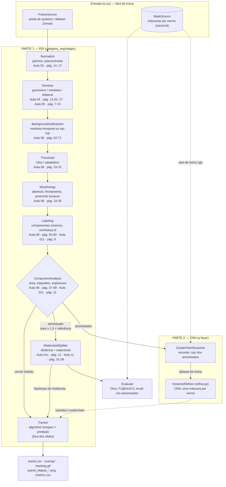
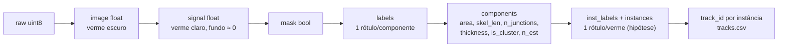

# Segmentação e rastreamento de *C. elegans* — PDI + CNN

Repositório: <https://github.com/Nixxye/PDI-C.Elegans>

Protótipo para o dataset do WormSwin ([Zenodo 7456803](https://zenodo.org/records/7456803), CC BY 4.0: `csb-1_dataset.zip`, `synthetic_images_dataset.zip`, `md_dataset.zip`).
Objetivo: **traçar cada verme individualmente ao longo dos quadros**, em duas partes:

| Parte | O que faz | Estado |
|---|---|---|
| **1. PDI** (este código) | Segmenta, separa o que dá por métodos clássicos, rastreia, e **entrega recortes dos amontoados** para a CNN | implementada |
| **2. CNN** | Distinguir vermes sobrepostos dentro de um amontoado | gancho pronto (`stages/refine.py`), rede ainda por fazer |

> Convenção de citação: `[Aula NN, pág. P]` = página **P do PDF** (índice da página no arquivo, não o número impresso no slide) da aula NN em `Estudos/PDI/Slides`. Está nos docstrings de cada função.

## Como rodar

```bash
pip install -r requirements.txt

# 1) sem dados reais: gera uma sequência sintética no mesmo formato do Zenodo
python tools/make_synthetic.py --out data/synthetic --seq seq0
python run_pdi.py --dataset-root data/synthetic --seq seq0 --out runs/synth

# 2) com o dataset real (descompactado em qualquer lugar)
python run_pdi.py --dataset-root D:/zenodo/csb-1_dataset --seq 24_2_1_1 --out runs/csb1
python run_pdi.py --images D:/outra/pasta/de/frames --out runs/meu_video     # sem gabarito

python -m unittest discover -s tests
```

**Trocar a entrada** não exige mexer no código: `--images <pasta>` (qualquer pasta de quadros), ou `--dataset-root` + `--seq`, ou os campos `input.*` do `config.yaml`. Qualquer parâmetro pode ser mudado por `--set secao.campo=valor` (ex.: `--set threshold.method=adaptive --set input.step=2`). Para vídeo (.avi/.mp4) basta criar outra `FrameSource` em `io.py` (3 métodos).

> Ajuste o `input.pattern`/`input.mask_pattern` se os nomes no seu download forem diferentes. O layout assumido (`images/<seq>/<k>.png`, `masks/<seq>/<k>_<i>.png`, uma máscara por verme) vem do protótipo anterior em `Estudos/PDI/Trabalho`; a página do Zenodo **não** descreve a estrutura interna dos zips, então confira ao descompactar.

## Datasets e origem

Ambos são **CC BY 4.0** (citar ao usar). Os dados ficam em `data/` (ignorada pelo git).

| Dataset | Origem | O que é | Como entra no projeto |
|---|---|---|---|
| **CSB-1** (WormSwin) | [Zenodo 7456803](https://doi.org/10.5281/zenodo.7456803) — Deserno & Bozek, 2023; artigo: *WormSwin: instance segmentation of C. elegans using vision transformer*, Sci. Rep. | **Vídeo** de placa (912×736, cinza gravado como RGB), uma máscara por verme, com sobreposição | Direto: `--dataset-root data/csb-1_extracted/csb-1_dataset --seq <seq>`. Único com continuidade temporal, logo o único para rastreamento |
| **Annotated images** | [Zenodo 15526615](https://doi.org/10.5281/zenodo.15526615) — Weheliye, Rodriguez, Feriani, Javer, Uhlmann & Brown, 2025; artigo: *A neural network model enables worm tracking in challenging conditions…*, PLOS Comput. Biol. 21(8): e1013345 | **Recortes independentes** (33–350 px) com 1–6 vermes; contorno e esqueleto por verme | Via conversor `tools/convert_annotated_images.py` (abaixo). Bom para a **CNN de separação** e para avaliar a segmentação; sem rastreamento |

Só o arquivo `Annotated_images.zip` (1,6 GB) do registro 15526615 é usado; os demais (`DT_C`, `PAF`, `Omnipose`, `Figures_Code`, 38,9 GB no total) são modelos e código do artigo.

### Annotated images: conversão e uso

O zip contém 13 arquivos `<fonte>_<split>.p.zip` que, na verdade, são **GZIP de pickles** (fontes: `manual`, `manual-v2`, `from_NNv1`, `from_tierpsy`). Como pickle pode executar código, o conversor usa um desserializador que só aceita as classes do NumPy presentes nesses arquivos e recusa o resto.

```bash
# extrair o zip numa pasta própria (data/annotated_raw) e converter os conjuntos de teste
python -I tools/convert_annotated_images.py --src data/annotated_raw/Annotated_images \
    --out data/annotated_converted --only manual-v2_test manual_test from_NNv1_test from_tierpsy_test --skeletons

# segmentar (recortes independentes: fundo por top-hat, moldura preta ignorada, sem rastreador)
python run_pdi.py --dataset-root data/annotated_converted --seq manual-v2_test --out runs/ann_manual-v2_test \
    --set background.method=tophat --set input.nodata_border=true \
    --set "stages=[normalize,denoise,background,threshold,morphology,labeling,analysis,split,refine,evaluate,export,visualize]"
```

Detalhes e ressalvas do conversor:
- Cada amostra: imagem em cinza, larguras (49 pts), esqueleto (49 pts) e contorno (98 pts) por verme. As **máscaras são o contorno preenchido** (uma por verme, sobreposição preservada). A ordem dos eixos do contorno é detectada automaticamente (contraste local) e foi conferida visualmente nos 4 conjuntos.
- `from_NNv1_*` **não traz contorno**: as máscaras são **reconstruídas** do esqueleto + largura (IoU médio ≈ 0,88 contra o contorno anotado, medido em `manual-v2_test`, que tem os dois). Tratar como gabarito aproximado.
- Não convertidos ainda: os `*_train`/`*_validation` (o `from_tierpsy_train` tem 1,2 GB compactado) e `from_tierpsy_negative` (formato diferente, recortes sem vermes). Basta incluí-los em `--only` (menos o `negative`).
- `input.nodata_border=true`: os recortes têm moldura preta (valor 0) que é **mais escura que o verme** e virava falso positivo; regiões de valor 0 ligadas à borda passam a ser "sem dado".

Resultado nos conjuntos de **teste** (pipeline de PDI, sem CNN; média por recorte, F1 por verme a IoU ≥ 0,5):

| Conjunto | vermes/recorte | F1 | recall em amontoados |
|---|---|---|---|
| `from_tierpsy_test` (1 verme, recortes fáceis) | 1,0 | 0,93 | 0,79 |
| `from_NNv1_test` (máscara reconstruída) | 1,65 | 0,71 | 0,52 |
| `manual_test` | 1,3 | 0,52 | 0,44 |
| `manual-v2_test` (mais sobreposição) | 2,1 | 0,44 | 0,24 |

O padrão é o esperado: o PDI vai bem em verme isolado e piora conforme aumenta a sobreposição, que é o que a CNN deve resolver. Atenção: parâmetros em pixels (`min_area`, `marker_min_dist`) foram deixados nos valores do CSB-1, e a escala dos recortes varia muito (de 33 a 350 px), então há margem para ajuste por conjunto.

## Arquitetura (pipeline de estágios)



Os estágios são classes com a mesma interface (`Stage.process(ctx)`, `core.py`). O `FrameContext` carrega o quadro e o que cada estágio produz (`image → signal → mask → labels → components → inst_labels → instances`). Estágios que precisam ver a sequência (fundo por mediana, área de referência de um verme) implementam `fit()`, que recebe quadros de amostra já processados pelos estágios anteriores. **Ordem, inclusão e remoção de estágios vêm de `stages:` no `config.yaml`**; um estágio novo é uma classe + uma linha em `stages/__init__.py`.

### O que cada estágio entrega



## Mapa slide → código

| Técnica | Slide | Onde |
|---|---|---|
| Gamma `s = c·rᵞ`, autocontraste | Aula 03, pág. 14, 17, 23-24 | `ops.gamma_correct`, `ops.autocontrast` |
| Vizinhança-8; distância (`bwdist`) | Aula 01c, pág. 9 e 11 | `ops.STRUCT_8`, `ops.distance_transform` |
| Gaussiano; mediana | Aula 04, pág. 13-20; 27-28 | `ops.gaussian`, `ops.median` |
| Filtro bilateral | Aula 05, pág. 7-15 | `ops.bilateral` |
| Otsu; limiar adaptativo | Aula 08, pág. 10-13; 14-15 | `ops.otsu_threshold`, `ops.local_mean_threshold` |
| Dilatação, erosão, abertura, fechamento | Aula 08, pág. 19-35 | `ops.opening`, `ops.closing` |
| Top-hat (iluminação) | Aula 08, pág. 62-71 | `ops.black_tophat`, `BackgroundSubtraction` |
| Esqueletização por afinamento | Aula 08, pág. 37-48 | `ops.thin` (Zhang-Suen), `ops.skeleton_stats` |
| Rotulagem em duas passadas | Aula 08, pág. 50-60 | `ops.two_pass_labeling` (didática, validada contra SciPy nos testes), `ops.label_components` |
| Watershed | Aula 11, pág. 31-39 | `stages/split.py` |
| RGB → cinza (0,299R+0,587G+0,114B) | Aula 10, pág. 2 | `io.to_gray_u8` |
| Pseudocolorização de rótulos | Aula 10, pág. 29 | `stages/viz.py` |
| Homomórfico (alternativa ao top-hat) | Aula 07, pág. 56-64 | não implementado |

Fora dos slides (e marcado assim no código): mediana temporal de fundo, rastreador húngaro, métricas Dice/F1.

## Saídas (`runs/<nome>/`)

| Arquivo | Conteúdo |
|---|---|
| `tracks.csv` | `frame, track_id, y, x, state, area, ambiguous` — trajetória de cada verme (`state=occluded`: trilha mantida por predição dentro de um amontoado) |
| `overlay/*.png`, `tracking.gif` | contorno + ID + rastro; contorno grosso = veio de amontoado (identidade menos confiável) |
| `painel_etapas_*.png` | resultado de cada etapa lado a lado (primeiro quadro + primeiros quadros com amontoado) — material para o relatório |
| `metrics.csv` | por quadro: Dice semântico, precisão/recall/F1@IoU 0,5, recall dos vermes que estão em amontoados |
| `cnn_dataset/<seq>/*.npz`, `index.csv` | **entrega para a CNN** (abaixo) |

## Entrega para a CNN (Parte 1 → Parte 2)

Cada amontoado vira um recorte `patch_size × patch_size` (padrão 128) centrado nele, com:
`image`, `signal`, `mask` (só aquele componente), `dist`, `skeleton`, `ws_labels` (proposta do watershed), `meta` (frame, bbox, `n_est`, `fits`) e, havendo gabarito, **`gt`: pilha (N, S, S) com uma máscara por verme, sobreposição preservada** (o alvo de treino). `ws_labels`, `dist` e `skeleton` são entradas auxiliares opcionais, o que permite ablação "CNN pura vs. CNN + informação clássica".

Para plugar a rede: subclasse de `InstanceRefiner` (`stages/refine.py`), implementar `refine_patch(patch) -> mapa de rótulos`, e `refine.kind` no config. O resto (rastreador, avaliação, visualização) não muda.

## Resultado de referência e limitações (honestas)

Na sequência sintética (`tools/make_synthetic.py`, 8 vermes em 320×320, 60 quadros): Dice semântico ≈ 0,88, mas F1@0,5 por instância ≈ 0,70 e **só ≈ 34 % dos vermes dentro de amontoados são recuperados** — exatamente o buraco que a CNN deve preencher. 

No **CSB-1 real**, sequência `24_2_1_1` (passo 2, 233 quadros, ~20 vermes/quadro): Dice semântico ≈ 0,77, precisão ≈ 0,63, recall ≈ 0,69, F1@0,5 ≈ 0,66, recall em amontoados ≈ 0,54; 278 recortes de amontoados exportados. Observações: (1) o fundo por mediana precisa ser estimado sobre a sequência inteira — com só 60 quadros consecutivos os vermes quase não se movem, entram no fundo e o F1 caiu para ≈ 0,07; (2) `labeling.min_area=150` foi escolhido numa varredura pequena **nesta mesma sequência**, então o número é otimista; (3) os IDs de trilha chegam a 40+ numa sequência com ~20 vermes: o rastreador fragmenta trilhas (vermes não detectados em alguns quadros, trocas em amontoados) e ainda precisa de ajuste.

- **Watershed por distância falha em vermes cruzados/paralelos colados** (não há "pescoço" na máscara). Por isso as instâncias vindas de amontoado são marcadas `ambiguous`.
- **Detecção de amontoado por área**: sobreposição reduz a área visível; a área de referência é a mediana dos componentes das amostras — se quase tudo for amontoado, ela fica inflada. Pode-se fixá-la com `analysis.ref_area`.
- **Verme parado entra no fundo da mediana** e some. Alternativa: `background.method=tophat`.
- **Rastreamento**: ID persiste fora de colisões; dentro delas a trilha é mantida por predição e pode trocar de identidade ao sair. Resolver isso bem é o papel da CNN + informação temporal.
- Parâmetros em pixels (`marker_min_dist`, `min_area`, `tophat_size`) foram calibrados no sintético; **revise-os com a resolução real do CSB-1 (912×736)**.
- Mediana temporal pressupõe câmera e placa estáticas.

## Estrutura

```
celegans-seg/
├── run_pdi.py            # CLI da parte 1
├── config.yaml           # entrada, parâmetros e ordem dos estágios
├── celegans_seg/
│   ├── config.py         # dataclasses + YAML + --set
│   ├── core.py           # Stage, FrameContext, Pipeline (fit/process/finish)
│   ├── io.py             # FrameSource, ImageFolderSource, MaskSource
│   ├── ops.py            # operações de PDI à mão, com citação dos slides
│   └── stages/           # preprocess, segment, analysis, split, refine, tracking,
│                         # evaluate, export, viz   (+ REGISTRY em __init__.py)
├── tools/make_synthetic.py   # sequência sintética com gabarito
└── tests/test_pipeline.py
```
